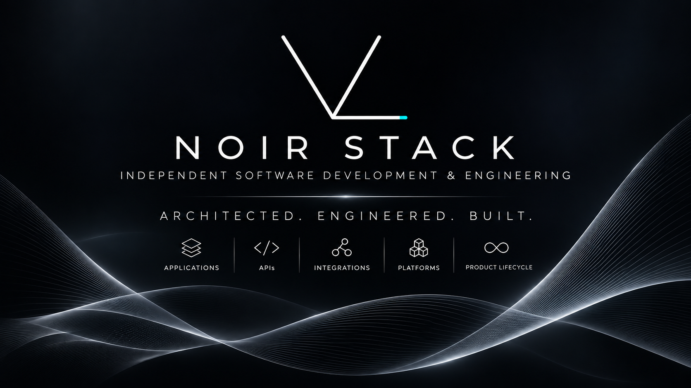

  

# Noir Stack

**Independent Software Development & Engineering**

Noir Stack is an independent software company specializing in the design, development, and commercialization of proprietary applications, APIs, integration technologies, and software platforms.

Through a combination of software architecture, engineering, and AI-assisted development, Noir Stack creates custom-built technologies designed to solve complex problems, connect systems, and enable new capabilities.

## Start here

- [Website](https://noirstack.com/) — company and product information
- [Public repositories](https://github.com/orgs/NoirStackLLC/repositories) — available projects and resources
- [Developer Lab](https://noirstack.com/lab) — browser-based development utilities

## Engineering approach

The company's development process encompasses the complete software product lifecycle—from concept and architectural design to programming, implementation, systems integration, testing, deployment, and ongoing maintenance.

All software products are developed in-house, with artificial intelligence integrated throughout the research, engineering, and development process.

## Ecosystem

Explore Noir Stack's applications, APIs, integration technologies, and software platforms on the [company website](https://noirstack.com/).

For the Cascades orchestration platform and its related projects, visit [cascades-work](https://github.com/cascades-work).

## Working with our repositories

Each project maintains its own documentation, licensing terms, and contribution guidance. Start with the relevant repository's README before using its code, opening an issue, or proposing a change.

## Connect

Visit [noirstack.com](https://noirstack.com/) for company information and contact options.

---

<strong>Architected. Engineered. Built.</strong>

