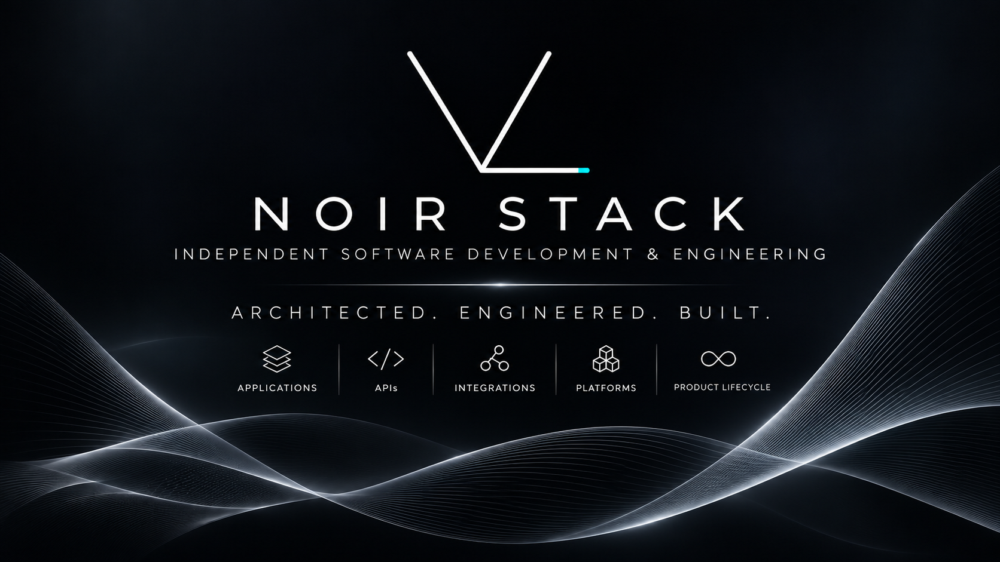
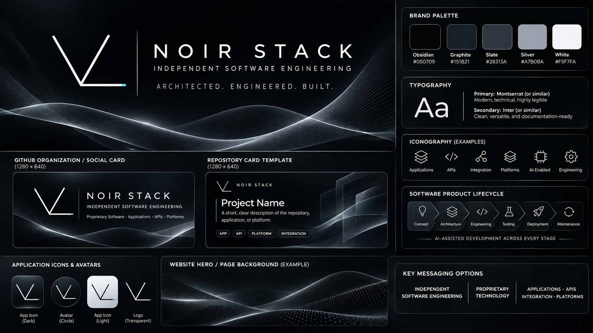

# Noir Stack branding assets

Original artwork supplied for Noir Stack's public GitHub presence. The images are preserved unchanged and grouped by intended use.

| Asset | Use |
| --- | --- |
| [Corporate card](social/corporate-card.png) | Featured image in the organization profile and repository README. |
| [Corporate brand board](brand/corporate-brand-board.png) | Reference for the logo, palette, typography, and visual language. |
| [Sample project card](templates/sample-project-card.png) | Visual reference for future repository cards; contains placeholder project text. |
| [Engineered for Complexity](web/engineered-for-complexity.png) | Website hero concept; navigation and buttons are part of the image. |
| [Engineered in Waves](banners/engineered-in-waves.png) | Vertical promotional banner. |
| [Intelligence in Motion](social/intelligence-in-motion.png) | Alternate social artwork with cyan wave accents. |

## Featured corporate card

## Brand reference

## Repository structure

- [Organization profile](../../profile/README.md)
- [Repository overview](../../README.md)

Use the corporate card for the current silver-wave presentation. Keep the sample project card as a reference until its placeholder text is replaced for a specific project.

## Additional Noir Stack assets

Copied from the `noirstack/` folder in `NoirStackLLC/brand-kit`. Original file bytes and filenames are preserved. Identical files already present here are reused; the repeated favicon package is consolidated into one set.

| Asset | Category |
| --- | --- |
| [Minimalist Black and Turquoise V Logo.png](logos/Minimalist%20Black%20and%20Turquoise%20V%20Logo.png) | logos |
| [Minimalist V Logo with Cyan Accent.png](logos/Minimalist%20V%20Logo%20with%20Cyan%20Accent.png) | logos |
| [Minimalist V Logo with Teal Accent.png](logos/Minimalist%20V%20Logo%20with%20Teal%20Accent.png) | logos |
| [Noir Stack AI Lifecycle Infographic.png](lifecycles/Noir%20Stack%20AI%20Lifecycle%20Infographic.png) | lifecycles |
| [Noir Stack Data Lifecycle Infographic.png](lifecycles/Noir%20Stack%20Data%20Lifecycle%20Infographic.png) | lifecycles |
| [Noir Stack Integration Card.png](social/Noir%20Stack%20Integration%20Card.png) | social |
| [Noir Stack Product Lifecycle.png](lifecycles/Noir%20Stack%20Product%20Lifecycle.png) | lifecycles |
| [Noir Stack SDLC Cyber-Tech Dashboard.png](lifecycles/Noir%20Stack%20SDLC%20Cyber-Tech%20Dashboard.png) | lifecycles |
| [Noir Stack Sci‑Fi Tech Banner.png](banners/Noir%20Stack%20Sci%E2%80%91Fi%20Tech%20Banner.png) | banners |
| [noirstack-16.png](favicons/noirstack-16.png) | favicons |
| [noirstack-180.png](favicons/noirstack-180.png) | favicons |
| [noirstack-192.png](favicons/noirstack-192.png) | favicons |
| [noirstack-32.png](favicons/noirstack-32.png) | favicons |
| [noirstack-48.png](favicons/noirstack-48.png) | favicons |
| [noirstack-512.png](favicons/noirstack-512.png) | favicons |
| [noirstack-favicon.ico](favicons/noirstack-favicon.ico) | favicons |

Source snapshot: `a667b4c59ec9c26a17ae88f8fbbd72f2252e5c2c`.
